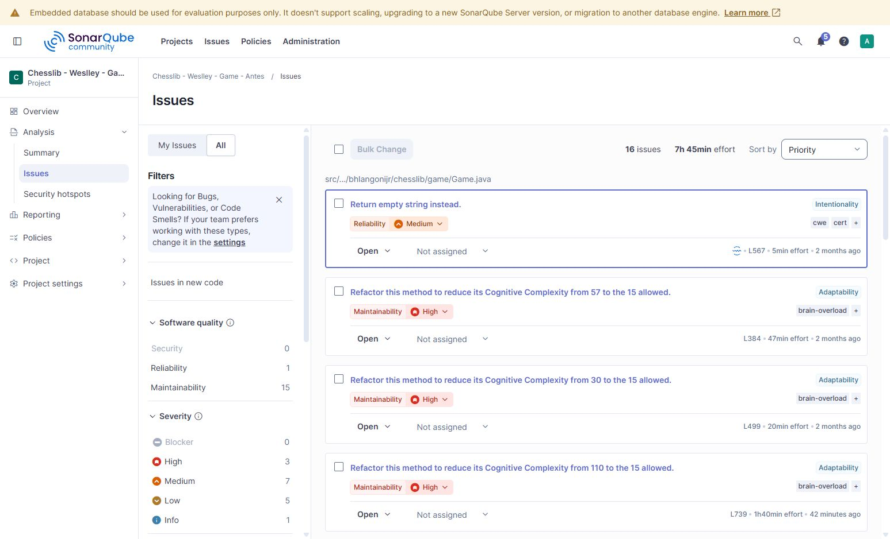
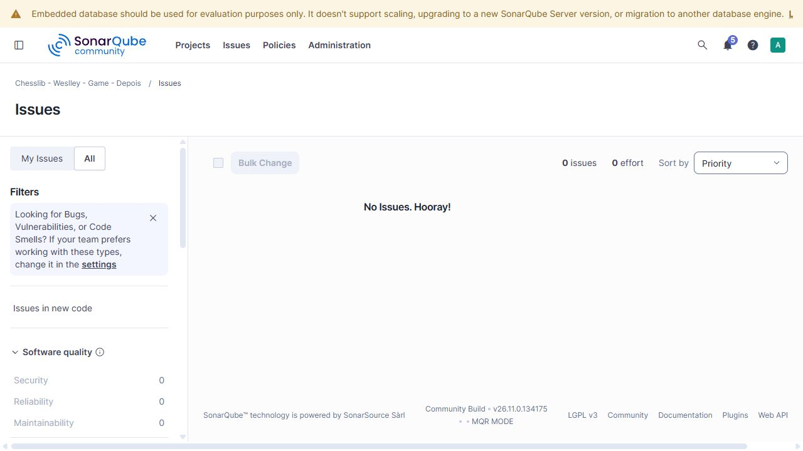

# Inspeção e correção de Game — Entrega 2

Responsável: Weslley Ribeiro. Data: 22/11/2026.

## Escopo e ambiente

Inspeção do arquivo `chesslib/src/main/java/com/github/bhlangonijr/chesslib/game/Game.java`, incluindo seus tipos internos. As classes dos outros integrantes não foram modificadas. A análise do Lucio com SonarQube for IDE/Eclipse registrava 16 apontamentos históricos em Game. A medição abaixo é uma nova execução, com ambiente identificado, sobre a versão que já contém os testes e as correções funcionais da branch de Weslley.

- SonarQube Community Build **26.11.0.134175**, imagem oficial `sonarqube:community`, digest `sha256:7b2296713a92b8ea0dd7a083a25faadc59376c9a1e6daf2744a89711c54ea1ba`.
- Analisador Java **8.46.0.59609**; SonarScanner Maven **5.3.0.6276**.
- Perfil oficial **Sonar way comprehensive**, **608 regras** ativas, mesmo identificador nos dois projetos. Nenhuma regra foi desativada e nenhum apontamento foi marcado como aceito/falso positivo para obter o resultado final.
- Regra `java:S3776`: limite padrão de complexidade cognitiva **15**.
- Escopo: somente o arquivo de produção de Game; testes excluídos da inspeção estática, mas executados como validação.
- Servidor de avaliação em Docker, acessível apenas por `127.0.0.1:9000`, com autenticação mantida. Não contém o ambiente institucional da equipe.
- Dois projetos locais preservam separadamente a fonte inicial e a final: `qet-weslley-game` e `qet-weslley-game-depois`.

O perfil padrão novo, Sonar way core, não incluía todos os achados de manutenção. Ele foi substituído pelo perfil completo **antes de estabelecer a linha de base**. A comparação oficial deste relatório usa comprehensive nos dois lados; não compara core com comprehensive.

## Resultado inicial e final

| Medida Sonar | Antes | Depois |
| --- | --- | --- |
| Total de apontamentos | **16** | **0** |
| Manutenibilidade / code smells | 15 | 0 |
| Confiabilidade / bugs | 1 | 0 |
| Vulnerabilidades | 0 | 0 |
| Complexidade cognitiva agregada | 218 | 109 |
| Complexidade ciclomática agregada | 174 | 177 |
| Linhas de código sem comentários (ncloc) | 613 | 633 |

A extração de métodos e os tratamentos explícitos de estado acrescentaram métodos/decisões; não se afirma redução da complexidade ciclomática agregada. A melhoria observada é a redução cognitiva e a ausência de métodos acima do limite 15 segundo S3776. Complexidade agregada Sonar e JaCoCo possuem escopos e convenções diferentes; não são intercambiáveis.

### Evidência inicial — 16 apontamentos em Game



Fonte inicial registrada na execução Sonar: commit `90c64bd15f267872afd66b4843a6fd43b79597ac`. A versão equivalente de código no histórico atual é `f42c79a394b1afad19a9a69cd6a778226cd59410`, após a reorganização dos registros de documentação. [Painel inicial local](http://localhost:9000/project/issues?issueStatuses=OPEN%2CCONFIRMED&id=qet-weslley-game).

### Evidência final — zero apontamentos no mesmo escopo



Fonte final registrada na execução Sonar: commit `fda91583c42a43b000f1b546f3388f680affa6b5`; a versão equivalente de código no histórico atual é `d4d98e681b41c246d4e5a1603fea2915672411de`. Game.java analisado com SHA-256 `EFCD3829B4B656532466561F780814C28C5A0D7E61A4EC16597D46692AAAB154`. A captura foi atualizada em seguida para identificar o painel como Game - Depois, sem mudar o código analisado. O código e as evidências foram integrados à main pelo [PR #16](https://github.com/sofiarecreio/trabalho-qet/pull/16), merge `f2f875e0394e28801fe832c6c5ffbda3644cffdc`. [Painel final local](http://localhost:9000/project/issues?issueStatuses=OPEN%2CCONFIRMED&id=qet-weslley-game-depois).

Os endereços localhost dependem do servidor desta máquina; as capturas versionadas permitem consultar a evidência sem esse acesso. O zero é restrito ao arquivo analisado e às regras ativas, não significa ausência de defeitos em todo Chesslib.

## Apontamentos e correções

Linhas abaixo referem-se à fonte inicial.

| Regra e quantidade | Local inicial | Correção | Resultado |
| --- | --- | --- | --- |
| S3776 — 3 | toPgn: 57; translateVariation: 30; loadMoveText: 110 | Separar cabeçalhos, anotações, linha principal e filhos de variações; separar normalização, classificação de tokens, comentários e fechamento de variações. | Nenhum método de Game apontado acima de 15. |
| S1155 — 2 | 433, 859 | `isEmpty()` para listas vazias. | Corrigidos. |
| S1117 — 2 | 456, 769 | Nome `annotationGlyph` e estado do parser com `variationStack`, sem esconder os campos de Game. | Corrigidos. |
| S6213 — 2 | 474, 867 | Renomear `var` para `alternative`. | Corrigidos. |
| S1172 — 1 | translateVariation, 499 | Remover parâmetro privado `parent` sem uso. Também retirar `lastSize` da recursão, onde apenas era repassado sem afetar a saída. | Corrigido. |
| S135 — 1 | Laço de tokens, 779 | Delegar o processamento de cada token; o laço não possui `continue`. | Corrigido. |
| S7158 — 2 | 800, 807 | Explicitar normalização com `StringUtils.trim(...).isEmpty()` na remoção de números. Não trocar por `String.isBlank()` indiscriminadamente, pois a semântica de caracteres Unicode/controle difere. | Corrigidos, sem supressão de regra. |
| S112 — 1 | loadMoveText, 739 | Declarar exceções específicas `MoveConversionException` e `PgnException`; a sobrecarga também foi atualizada. | Corrigido. |
| S1135 — 1 | TODO em toString, 565 | Tratar metadados obrigatórios ausentes e permitir partida vazia sem texto bruto. Remover TODO após implementar o tratamento e os testes. | Corrigido. |
| S2225 — 1 | Retorno nulo em toString, 567 | Retornar string vazia em falha de conversão e em instância incompleta. | Corrigido, com mudança de contrato explícita. |

Os tipos internos `MoveTextState` e `VariationRenderState` guardam dados; o processamento permanece em métodos de **Game**. Não foi deslocado para uma classe fora dos filtros de JaCoCo/PIT para melhorar artificialmente os percentuais.

## Mudanças de comportamento e compatibilidade

O PGN esperado para os cenários válidos de movimentos, variações e comentários foi preservado, incluindo ordem, espaços, retomada da linha principal e vínculo ao pai. Os parâmetros públicos `includeVariations` e `includeComments` continuam documentados como ignorados; esta inspeção não implementa esses filtros.

Há duas mudanças intencionais de robustez: `toString()` devolve `""` quando faltam metadados obrigatórios ou quando a conversão SAN falha, e uma partida com metadados completos, sem lances e sem texto bruto passa a gerar cabeçalhos e resultado, em vez de lançar NPE. O caso anterior que exigia nulo foi atualizado porque o contrato escolhido mudou, não para esconder uma falha inesperada. Foram acrescentados dois casos para as novas situações. Consumidores que verificavam nulo em `toString()` devem observar essa alteração. A restrição de `throws Exception` também pode exigir ajustes em subclasses externas que sobrescrevam a assinatura com exceções mais amplas.

O tratamento de exceção ao fechar uma variação continua a preservar a causa e o contexto. Foi limitado a `RuntimeException`, pois os colaboradores usados nesse trecho não declaram exceções verificadas. A normalização de letras do término usa `Locale.ROOT`, evitando dependência do idioma da máquina.

## Validação após as correções

| Validação | Resultado final |
| --- | --- |
| Regressão Chesslib | **307 testes**, zero falhas/erros/ignorados |
| Suítes da classe Game | **89 casos**, cinco suítes; GameQualityTest tem 15 |
| JaCoCo 0.8.12, branches de Game | **166/179 = 92,74%**, regra mínima de 80% aprovada |
| JaCoCo, linhas de Game | 371/378 = 98,15% |
| PIT 1.17.4, mutação de Game | **203/213 = 95,31%**, limite mínimo de 80% aprovado |
| Estados PIT restantes | 7 sobreviventes, 3 sem cobertura, zero erros de execução |

As contagens mudaram com a refatoração: havia 218 branches e 208 mutantes antes, agora há 179 branches e 213 mutantes. Os percentuais não representam os mesmos itens individuais. A eliminação de verificações redundantes explica parte da redução de branches. Os mutantes de métodos novos não devem ser comparados por índice com os anteriores.

Os três mutantes sem cobertura estão nos caminhos de delimitadores sem abertura (`}` e `)`) e no retorno de uma variação nula fornecida pelo setter. Os sete sobreviventes envolvem a inicialização redundante de posição, quebra exata em 80 caracteres, paridade do número inicial, fechamento antecipado de filhos e limite do índice zero de uma variação. Permanecem no denominador; nenhuma equivalência foi usada para descontá-los. A meta está atendida, mas esses limites continuam explícitos.

```text
mvn -B -f chesslib/pom.xml "-Dtest=Game*Test" test
mvn -B -f chesslib/pom.xml -Pgame-quality "-Dmaven.javadoc.skip=true" clean verify
mvn -B -f chesslib/pom.xml -Pgame-quality "-Djacoco.skip=true" test-compile org.pitest:pitest-maven:1.17.4:mutationCoverage
```

O primeiro comando seleciona também GameLoaderTest por padrão de nome: foram 94 casos na etapa inicial de correções pequenas. A regressão final completa é a fonte do total de 307; não se apresenta o número de execuções internas do PIT como quantidade de casos de teste do projeto.

Para reproduzir Sonar, usar token temporário na variável de ambiente `SONAR_TOKEN`, sem gravá-lo no repositório:

```text
mvn -B -f chesslib/pom.xml org.sonarsource.scanner.maven:sonar-maven-plugin:5.3.0.6276:sonar "-Dsonar.host.url=http://localhost:9000" "-Dsonar.projectKey=qet-weslley-game-depois" "-Dsonar.projectName=Chesslib - Weslley - Game - Depois" "-Dsonar.inclusions=src/main/java/com/github/bhlangonijr/chesslib/game/Game.java" "-Dsonar.test.exclusions=**/*" "-Dsonar.coverage.jacoco.xmlReportPaths=target/site/jacoco-game/jacoco.xml"
```

O projeto deve estar associado ao perfil comprehensive antes de estabelecer os resultados comparativos. Fonte técnica: [SonarScanner for Maven](https://docs.sonarsource.com/sonarqube-community-build/analyzing-source-code/scanners/sonarscanner-for-maven).

## Decisão e pendências

Aceitar as correções e a refatoração porque o mesmo perfil eliminou os 16 apontamentos, os oráculos completos de PGN passaram e as metas de cobertura e mutação foram mantidas na produção final. A revisão não depende apenas do resultado verde dos testes: os casos verificam conteúdo e estrutura de saída e o PIT verifica sensibilidade a alterações na lógica.

Não há apontamento Sonar remanescente de Game a justificar em issue nesta execução. A seção 5 do [relatório compartilhado](https://docs.google.com/document/d/1LBd-p5gI73bchdHi-wWXTSUu7rfhmelV1IxTPfpdvk8/edit) foi atualizada com correções, validação e capturas, e as tabelas de consolidação receberam os dados de Game. O documento foi padronizado, preservando o conteúdo dos colegas. Código e evidências de Weslley estão na main pelo PR #16. Permanecem a conferência individual e a consolidação das demais classes pelos respectivos responsáveis. A relação entre branches JaCoCo e o critério acadêmico todas-arestas está explicitada no [relatório técnico de Game](../../entrega2/weslley/game-testes-integracao.md#relação-com-todas-arestas) e continua a esclarecer no critério acadêmico; o Sonar não resolve essa distinção.
