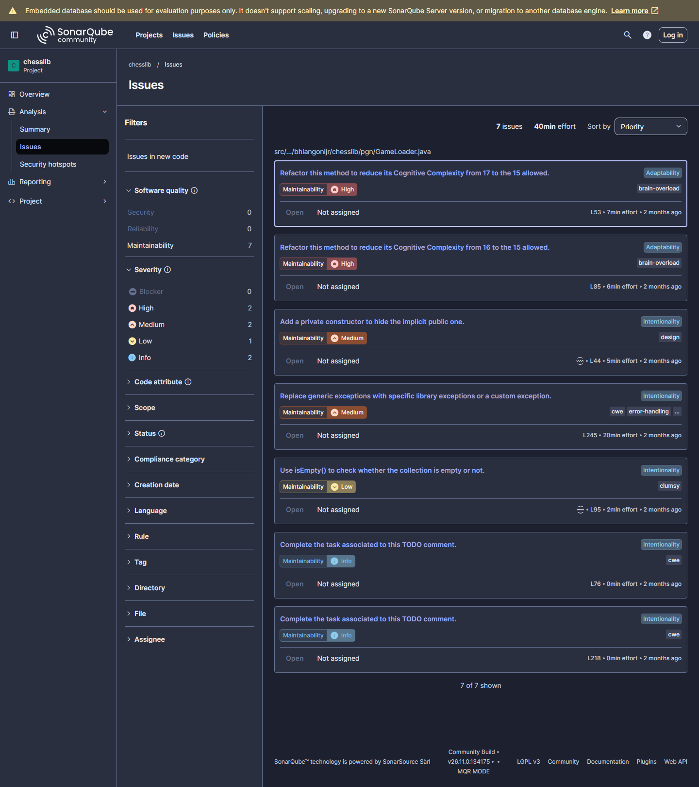
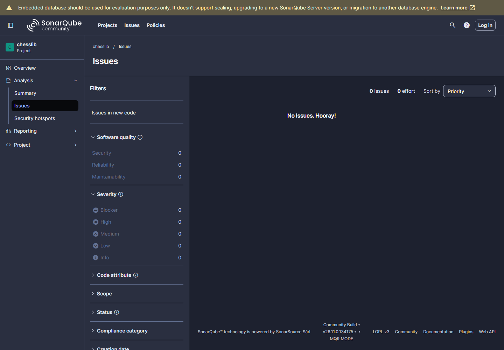

# GameLoader — inspeção e correções

Responsável pela atividade: Sofia Recreio. Análise local: 23/11/2026.

Foram usados dois projetos locais separados para a fonte inicial e a corrigida. As duas análises usam o mesmo perfil de regras e o mesmo escopo. Nenhuma regra foi desativada e nenhum apontamento foi aceito ou marcado como falso positivo para obter o resultado final.

- Base: commit `33b624799648e294457098921608d135a1e92155` (branch `sofia/entrega-2`, já com os 14 testes de GameLoaderTest).
- SHA-256 da fonte inicial: `2ef09ad604201463aa32c91fd842fab767ebe77725f4c989a2069573d986685f`.
- SHA-256 da fonte corrigida: `f8688bf87607176257d241b91a5f62dd8ffc65b99561a8e313a8a2d8ae747741`.
- SonarQube Community Build **26.11.0.134175**, imagem oficial `sonarqube:community`, digest `sha256:7b2296713a92b8ea0dd7a083a25faadc59376c9a1e6daf2744a89711c54ea1ba` — o mesmo servidor usado nas inspeções de Game e PgnHolder.
- SonarScanner Maven 5.3.0.6276; Java 21.0.12; Windows.
- Perfil **Sonar way comprehensive**, 608 regras ativas, associado aos dois projetos antes da análise inicial.
- Escopo: somente `src/main/java/com/github/bhlangonijr/chesslib/pgn/GameLoader.java`; testes excluídos da inspeção estática, mas executados como validação.
- Servidor em Docker acessível apenas em `127.0.0.1` (porta 9010, porque a 9000 estava ocupada na máquina).

## Resultado

| Medida Sonar | Antes | Depois |
| --- | ---: | ---: |
| Total de apontamentos | **7** | **0** |
| Manutenibilidade / code smells | 7 | 0 |
| Confiabilidade / bugs | 0 | 0 |
| Vulnerabilidades | 0 | 0 |
| Security hotspots | 0 | 0 |
| Complexidade cognitiva agregada | 42 | 32 |
| Complexidade ciclomática agregada | 49 | 62 |
| Linhas de código sem comentários (ncloc) | 225 | 244 |

A complexidade cognitiva caiu porque os dois métodos acima do limite foram divididos. A ciclomática agregada e as linhas aumentaram porque cada método novo soma ao menos 1 de complexidade. Não se afirma redução da complexidade ciclomática; a melhoria comprovada é a resolução dos apontamentos no mesmo perfil.

### Capturas reais





Dados originais de regras, linhas, mensagens, perfil e métricas: [sonar-antes.json](sonar-antes.json) e [sonar-depois.json](sonar-depois.json). O campo de autoria que o Sonar obtém do git foi removido dos JSONs; os demais dados são os devolvidos pela API.

## Apontamentos e correções

| # | Regra | Severidade | Linha (antes) | Apontamento | Correção |
| --- | --- | --- | ---: | --- | --- |
| 1 | S3776 | Crítica (High) | 53 | Complexidade cognitiva de `loadNextGame` = 17 (limite 15) | Remoção do BOM extraída para `removeBom`; o tratamento de cada linha passou para `processLine`, que informa quando a partida terminou |
| 2 | S3776 | Crítica (High) | 85 | Complexidade cognitiva de `addProperty` = 16 (limite 15) | Casos com lógica própria extraídos para `setEvent`, `setRound`, `parseTermination`, `setTimeControl`, `setElo` e `addCustomProperty`; o `switch` só despacha |
| 3 | S1118 | Maior (Medium) | 44 | Classe utilitária com construtor público implícito | Construtor privado; a classe só tem métodos estáticos |
| 4 | S112 | Maior (Medium) | 245 | `setMoveText` declara `throws Exception` | Retirado `throws Exception` de `setMoveText` e de `addProperty`: nenhuma operação chamada lança exceção verificada (`MoveConversionException` e `PgnException` são `RuntimeException`) |
| 5 | S1155 | Menor (Low) | 95 | `getHalfMoves().size() == 0` | `getHalfMoves().isEmpty()` |
| 6 | S1135 | Info | 76 | `TODO stricter exceptions` | Tarefa realizada: o `catch (Exception)` virou `catch (RuntimeException)`, o único tipo possível depois do item 4. O comentário TODO foi substituído pela explicação |
| 7 | S1135 | Info | 218 | `TODO many of this stuff can be accessed through game` | Tarefa realizada: o contêiner de leitura deixou de guardar cópias de evento, rodada e jogadores; eles são obtidos da própria partida (`game.getRound()`, `getRound().getEvent()`, `getWhitePlayer()`, `getBlackPlayer()`) |

Os itens 6 e 7 não foram resolvidos apagando o comentário: em ambos, o que o TODO pedia foi implementado.

## Compatibilidade

- O comportamento da leitura não mudou: mesmas mensagens de `PgnException`, mesmo tratamento de tags, resultados, comentários e BOM.
- Trocar `catch (Exception)` por `catch (RuntimeException)` é equivalente, porque o bloco não chama nada que lance exceção verificada. Isso é confirmado pela compilação: sem o `throws Exception`, qualquer exceção verificada não tratada impediria o build.
- O construtor privado impede `new GameLoader()`. Não há uso no repositório (o único consumidor, `PgnIterator`, chama o método estático), mas código externo que instanciasse a classe deixaria de compilar.

## Validação

| Verificação | Resultado |
| --- | --- |
| Regressão completa do Chesslib | **349 testes, zero falhas, erros ou ignorados** ([resumo](regressao-completa.txt)) |
| Cobertura de branches de GameLoader (regressão completa) | **60/68 = 88,24%** (antes da inspeção: 58/66 = 87,88%) — [XML](jacoco-apos-inspecao.xml) |
| Mutação (PIT, GameLoaderTest) | **71/75 KILLED = 94,67%** (antes da inspeção: 59/63 = 93,65%) — [XML](mutations-apos-inspecao.xml), [resumo](pit-resumo.txt) |

O total de mutantes passou de 63 para 75 e o de branches de 66 para 68 porque a refatoração criou métodos e decisões novas; por isso os números absolutos não são comparáveis um a um. Os quatro mutantes restantes são os mesmos da medição anterior, apenas em métodos novos: três em `setEvent` (dois na condição e um na chamada a `setMoveText`, para texto de lances antes de uma nova tag Event) e um na fronteira de `round < 1` em `setPlayerDetails`. Ambas as metas de 80% continuam atendidas.

## Reprodução

Validação (a partir da raiz):

```text
mvn -B -f chesslib/pom.xml -Pgameloader-quality "-Dmaven.javadoc.skip=true" verify
mvn -B -f chesslib/pom.xml -Pgameloader-quality test-compile org.pitest:pitest-maven:mutationCoverage
```

Análise Sonar: subir o servidor, associar o projeto ao perfil Sonar way comprehensive e definir um token local na variável `SONAR_TOKEN`:

```text
docker run -d --name qet-sonar -p 127.0.0.1:9010:9000 sonarqube:community
mvn -B -f chesslib/pom.xml -DskipTests compile
mvn -B -f chesslib/pom.xml org.sonarsource.scanner.maven:sonar-maven-plugin:5.3.0.6276:sonar -Dsonar.host.url=http://127.0.0.1:9010 -Dsonar.projectKey=qet-sofia-gameloader-depois -Dsonar.inclusions=src/main/java/com/github/bhlangonijr/chesslib/pgn/GameLoader.java "-Dsonar.test.exclusions=**/*"
```

## Limites

O zero vale apenas para este arquivo e para as 608 regras do perfil usado; não comprova ausência de defeitos no sistema. Os painéis locais dependem do servidor Docker desta máquina; os JSONs e as capturas permitem conferir o resultado sem ele. Os dois `catch (Exception)` de `parseTermination` e `setTimeControl` foram mantidos como estavam, porque não foram apontados pelo perfil e estreitá-los poderia mudar o comportamento com tags inválidas.
