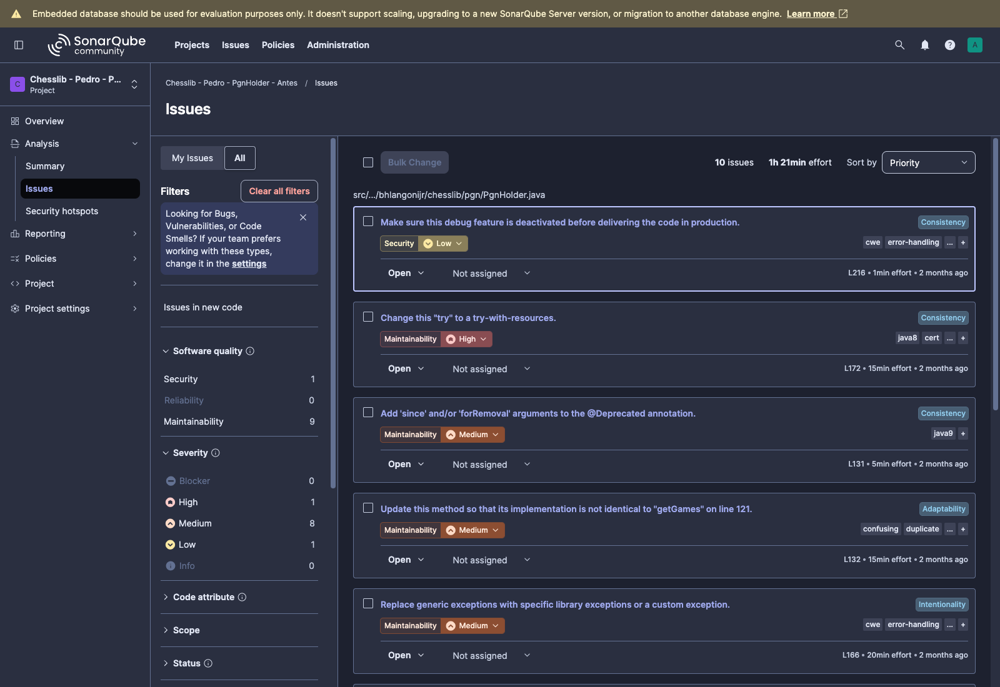
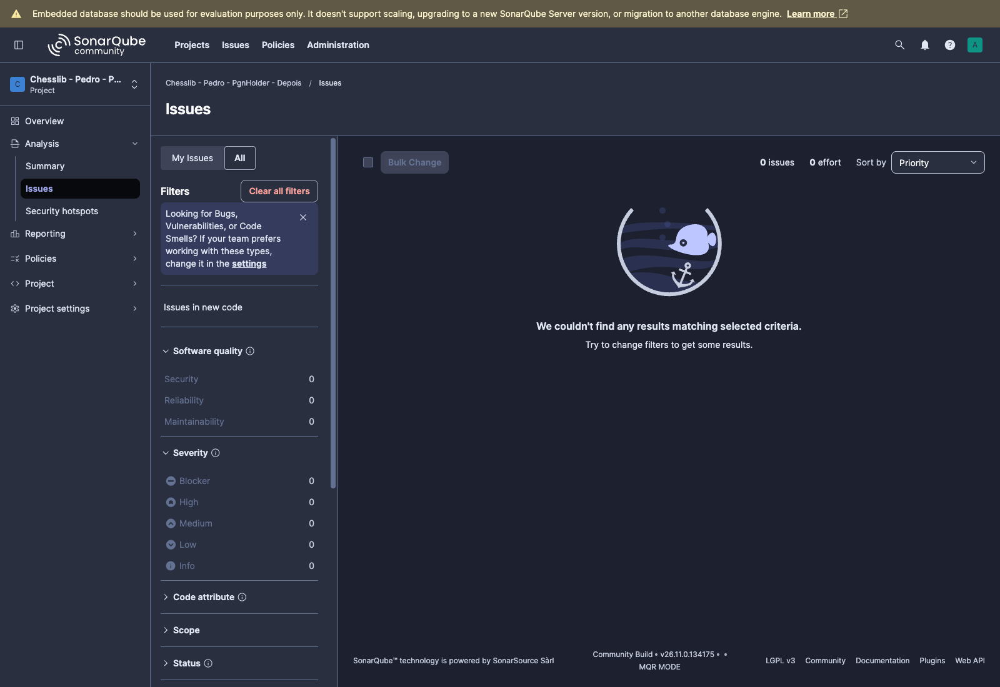

# PgnHolder — inspeção e correções

Responsável pela atividade: Pedro Piaes. Análise inicial local: 22/11/2026.

Foram preservados projetos locais separados para a fonte inicial e a corrigida. As duas análises usam o mesmo perfil de regras e o mesmo escopo. Nenhuma regra foi desativada e nenhum apontamento foi aceito ou marcado como falso positivo para obter o resultado final.

- Base: commit `4750daac2045f5d16e841a5c7ea1011afdda9b5d`.
- SHA-256 da fonte: `d84be678858d3f474f6df15d089c4328f0ef6be3757786aaf72038e90c88a762`.
- SonarQube Community Build 26.11.0.134175, imagem oficial `sonarqube:community`, digest `sha256:7b2296713a92b8ea0dd7a083a25faadc59376c9a1e6daf2744a89711c54ea1ba`.
- SonarScanner Maven 5.3.0.6276; JDK 21.
- Perfil **Sonar way comprehensive**, 608 regras ativas, selecionado antes da análise inicial.
- Escopo: somente `src/main/java/com/github/bhlangonijr/chesslib/pgn/PgnHolder.java`; testes excluídos da inspeção estática.

## Resultado inicial

| Medida | Resultado |
| --- | ---: |
| Apontamentos | 10 |
| Code smells | 9 |
| Vulnerabilidades classificadas pelo analisador | 1 |
| Bugs classificados pelo analisador | 0 |
| Complexidade ciclomática agregada | 35 |
| Complexidade cognitiva agregada | 26 |
| Linhas de código sem comentários | 149 |

As classificações são as devolvidas pelo analisador, não uma comprovação de exploração de vulnerabilidade. Os apontamentos abrangem anotação de depreciação, implementação duplicada, exceção genérica, variáveis que ocultam campos, fechamento de recursos e impressão de stack trace.

Os dados originais de regras, linhas, mensagens, perfil e métricas estão preservados em [sonar-antes.json](sonar-antes.json). O projeto local independente mantém a análise inicial em [PgnHolder — Antes](http://localhost:9000/dashboard?id=qet-pedro-pgnholder-antes). Esse endereço depende do servidor local; o JSON pode ser consultado sem o servidor.

## Resultado final

| Medida | Antes | Depois |
| --- | ---: | ---: |
| Apontamentos | 10 | 0 |
| Code smells | 9 | 0 |
| Vulnerabilidades classificadas pelo analisador | 1 | 0 |
| Bugs classificados pelo analisador | 0 | 0 |
| Complexidade ciclomática agregada | 35 | 36 |
| Complexidade cognitiva agregada | 26 | 27 |
| Linhas sem comentários | 149 | 150 |

As complexidades agregadas aumentaram devido ao tratamento explícito de falha de escrita. Não se afirma redução dessas métricas: a melhoria comprovada é a resolução dos apontamentos no mesmo perfil e a cobertura de regressão acrescentada.

### Capturas reais





[Dados finais originais](sonar-depois.json). A fonte corrigida está identificada por SHA-256 nesse arquivo. Enquanto não houver commit das alterações, esse hash identifica o conteúdo efetivamente analisado.

## Correções e decisões

| Apontamento | Tratamento |
| --- | --- |
| S6355 — depreciação | Tornar explícito `forRemoval = false`, sem inventar uma versão histórica de depreciação |
| S4144 — implementação duplicada | `getGame()` delega a `getGames()`, preservando a mesma lista mutável |
| S112 — exceção genérica | Retirar `throws Exception` de `loadPgn(LargeFile)`, que não executa operações com exceções verificadas; manter a assinatura sem argumentos exigida pelo construtor de LargeFile |
| S1117 — cinco variáveis ocultando campos | Usar `parsedGames`, `chessEvent` e `existingEvent` |
| S2093 — fechamento de recurso | Adotar try-with-resources em `loadPgn(LargeFile)`; a construção do iterador agora fica dentro do bloco protegido |
| S4507 — impressão de stack trace | Propagar `UncheckedIOException` com contexto e causa em `savePgn()` |

Também foi fechado explicitamente o Stream de `Files.lines` em `countGamesInPgnFile`, e a gravação passou a usar try-with-resources e `PrintWriter.checkError()` para detectar falhas de escrita.

## Compatibilidade e validação

`savePgn()` deixa de aparentar sucesso após erro de IO: agora lança `UncheckedIOException`. Isso é uma mudança intencional de contrato, verificada por teste de destino inexistente. O formato das partidas válidas foi preservado. Consumidores que dependiam do erro apenas no console devem tratar a exceção.

Retirar a exceção verificada da sobrecarga `loadPgn(LargeFile)` mantém seu comportamento de execução, mas subclasses externas que a sobrescrevam declarando exceções verificadas amplas podem exigir ajuste. O método sem argumentos continua declarando a exceção do construtor preexistente de LargeFile.

Foram adicionados oito casos em `PedroPgnHolderQualityTest`: alias da lista, gravação e recarga com preservação de metadados e lances, destino inexistente, gravação vazia, contagem sem carregamento, arquivo ausente, fechamento após sucesso e fechamento quando a criação do iterador falha. A regressão completa executou **341 testes, zero falhas, erros ou ignorados**.

Como verificação dos testes de regressão, os oito casos foram executados também contra a fonte original de PgnHolder, compilada separadamente em diretório temporário. Dois falharam, identificando o recurso não fechado na falha de inicialização e o erro de gravação não propagado. Os oito passam na fonte corrigida. [Saída com fonte anterior](testes-fonte-anterior.txt), [oito testes após correção](testes-regressao.txt) e [regressão completa de 341 testes](regressao-completa.txt).

O PGN de ida e volta define explicitamente `TimeControl` para não confundir a inspeção com a normalização preexistente de controle desconhecido (`-` para `?`).

```sh
mvn -B -f chesslib/pom.xml -Ptimecontrol-quality -Dmaven.javadoc.skip=true verify
```

Para repetir a análise, associar o projeto ao perfil Sonar way comprehensive e definir um token local na variável `SONAR_TOKEN`:

```sh
mvn -B -f chesslib/pom.xml org.sonarsource.scanner.maven:sonar-maven-plugin:5.3.0.6276:sonar -Dsonar.host.url=http://localhost:9000 -Dsonar.projectKey=qet-pedro-pgnholder-depois -Dsonar.inclusions=src/main/java/com/github/bhlangonijr/chesslib/pgn/PgnHolder.java '-Dsonar.test.exclusions=**/*'
```

## Limitações e integração

O conector não tinha permissão para o relatório compartilhado, e esta comparação foi produzida em ambiente local identificado. Posteriormente, a seção 6.1 e as linhas de PgnHolder nas tabelas foram atualizadas pela conta Google de Pedro, no navegador, com as duas capturas. O zero é restrito ao arquivo e às regras analisadas; não comprova ausência de defeitos em todo o sistema. O código e as evidências pertencem à branch `pedro/entrega2`. A integração na main deve ser realizada pelo responsável pelo merge após a revisão. As correções se relacionam às Issues [#21](https://github.com/sofiarecreio/trabalho-qet/issues/21) e [#22](https://github.com/sofiarecreio/trabalho-qet/issues/22), ainda abertas até essa integração.
